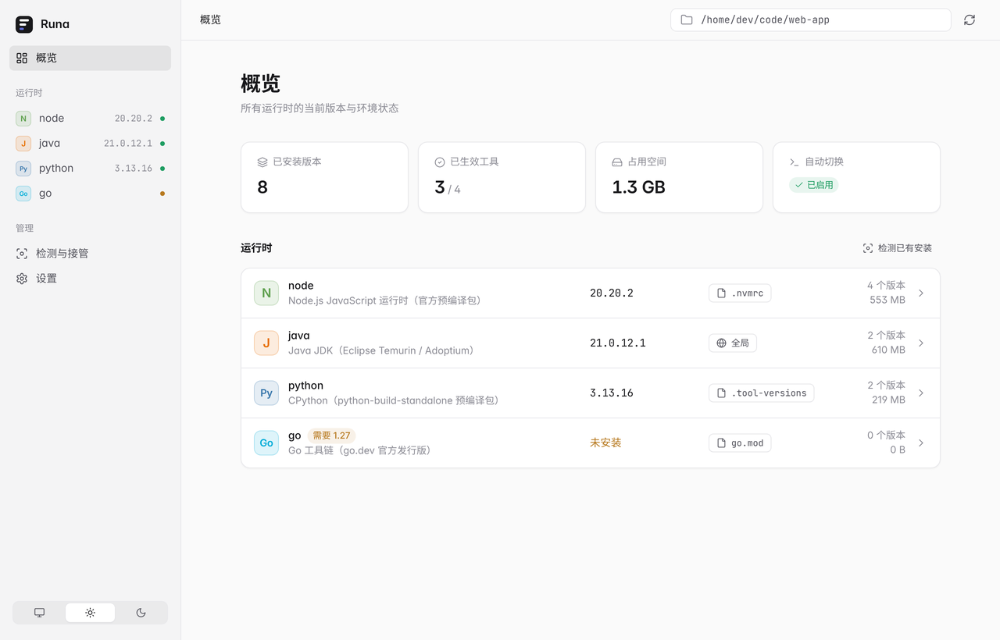
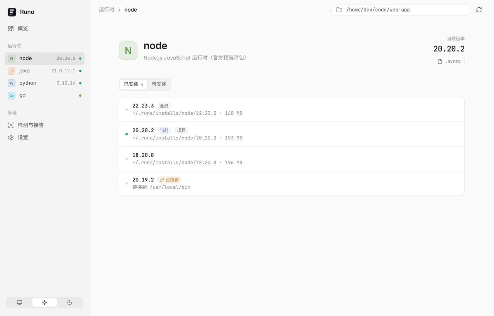
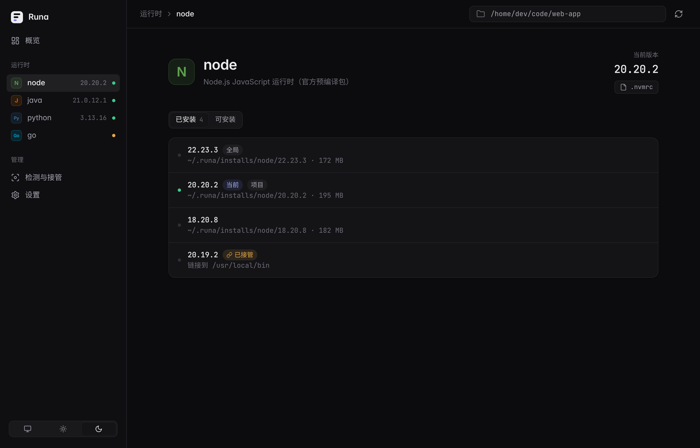
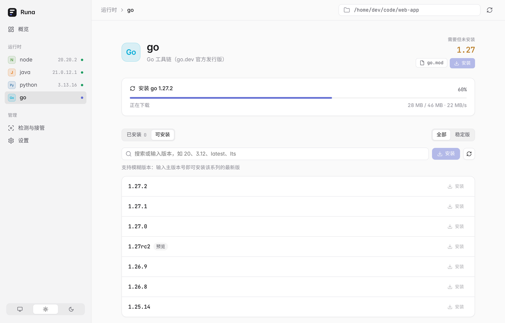
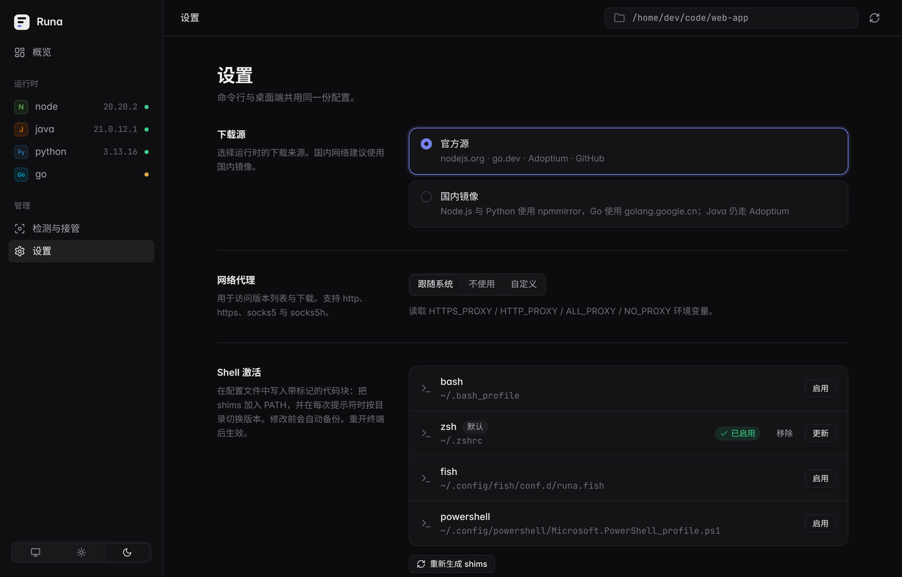

<div align="center">


# Runa

**跨平台多语言运行时版本管理器：Node.js / Java / Python / Go / Rust / Ruby / Bun / Deno 多版本切换，命令行 + 桌面客户端 + MCP 服务。**

[English](README.md) · 简体中文

[](https://github.com/xyunjie/runa/actions/workflows/ci.yml)
[](LICENSE)


</div>

**Runa** 是一个跨平台（Windows / macOS / Linux）的多语言运行时版本管理器，用 Rust 编写，提供命令行工具 `runa` 和基于 Tauri v2 的桌面客户端。一个工具统一管理 Node.js、Java、Python、Go、Rust、Ruby、Bun、Deno 等开发版本（Ruby 通过 rbenv / rvm / mise / asdf 安装，Rust 推荐 rustup），并兼容 asdf 的 `.tool-versions`。可以作为 nvm、pyenv、SDKMAN!、asdf / mise 的替代或补充：一套工具完成 Node.js 版本管理、Java 版本切换、Python 多版本切换，并按项目自动切换版本。

功能设计参考了 [hquip/Vaelen](https://github.com/hquip/Vaelen)（Go + Wails 实现的 `vsm`）。



## 特性

- **隔离安装**：每个版本装在 `~/.runa/installs/<工具>/<版本>`，切换版本只改指针（`.tool-versions`），不复制、不覆盖。
- **自动解析版本**，优先级从高到低：
  1. 环境变量 `RUNA_<TOOL>_VERSION`（如 `RUNA_NODE_VERSION=20`）
  2. 从当前目录向上查找，最近的目录优先：`.tool-versions`，以及各语言的常用文件
     `.nvmrc` / `.node-version` / `package.json` 的 `engines.node`、`.python-version`、`.java-version` / `.sdkmanrc`、`.go-version` / `go.mod`（`toolchain` 优先于 `go` 指令）
  3. 没有显式版本文件时读取构建文件：Java 读 Maven `pom.xml`（编译器 release / source / target、`java.version`、父 POM）与 Gradle（`JavaLanguageVersion.of`、`jvmToolchain`、`sourceCompatibility`）；Python 读 `pyproject.toml` 的 `requires-python` / Poetry、`Pipfile`、`setup.py` 的 `python_requires`、项目 `.venv`
  4. 全局 `~/.runa/.tool-versions`
- **模糊版本**：`20`、`3.12`、`latest`、`lts`、`^18.2`、`>=18`、`18.x`、`temurin-21`、`go1.22` 等。
- **两种激活方式**：shell 钩子（bash / zsh / fish / PowerShell）在每次提示符时重建 PATH；shims 作为兜底（IDE、脚本、非交互 shell）。
- **内置插件**：
  | 工具 | 来源 | 校验 |
  |---|---|---|
  | node | nodejs.org/dist 官方预编译包 | `SHASUMS256.txt` |
  | java | Eclipse Temurin（Adoptium API） | API 提供的 SHA256 |
  | python | astral-sh/python-build-standalone（`install_only`，免编译） | `SHA256SUMS` |
  | go | go.dev/dl | JSON 元数据中的 SHA256 |
- **JSON 声明式插件**：在 `~/.runa/plugins/*.json` 描述下载地址即可管理 deno、bun 等更多工具，示例见 [`examples/plugins/sample.json`](examples/plugins/sample.json)。
- **检测与接管**：扫描 PATH、`JAVA_HOME`、`GOROOT`、常见目录以及 nvm / pyenv / SDKMAN! / asdf / fnm / Homebrew Cellar 的版本仓库；接管只登记真实安装位置（不建链接），原安装不受影响。详见 [检测、接管与卸载](#检测接管与卸载)。
- **镜像与代理**：一键切换国内镜像（npmmirror、golang.google.cn），代理支持 `http` / `https` / `socks5` / `socks5h`、`off`、`system`。
- **安全**：解压时防 zip-slip（拒绝 `..`、绝对路径以及指向目录外的符号链接）；上游提供校验值时强制 SHA256 校验。

## 快速上手

```bash
runa install node 20          # 安装 20.x 的最新版（首次安装的版本自动设为全局默认）
runa install java 21
runa install python 3.12
runa use node 22              # 写入当前目录的 .tool-versions
runa use -g go latest         # 设为全局版本（未安装会自动安装）
runa current                  # 查看当前目录生效的版本及来源
runa setup                    # 一键把激活脚本写入 shell 配置文件，重开终端生效
```

不想改 shell 配置时，也可以手动启用：

```bash
# bash / zsh
eval "$(runa activate bash)"     # zsh 用 runa activate zsh
# fish
runa activate fish | source
# PowerShell
(& runa activate powershell | Out-String) | Invoke-Expression
```

## 命令一览

| 命令 | 说明 |
|---|---|
| `runa install [工具] [版本] [--require-checksum]` | 安装；支持 `node@20` 写法；不带参数时安装当前目录需要但缺失的全部版本；`--require-checksum`（或 `RUNA_REQUIRE_CHECKSUM=1`）在上游没有 SHA256 时拒绝安装 |
| `runa uninstall <工具> <版本> [--forget\|--purge] [--dry-run]` | 卸载；接管的版本必须选择 `--forget`（只移除管理）或 `--purge`（通过所属工具彻底卸载）；`--dry-run` 只打印将执行的命令与路径 |
| `runa disable <工具> <版本>` / `runa enable <工具> <版本>` | 禁用 / 启用某个版本（禁用后仍在列表中，但不会被解析、生成 shim 或加入 PATH） |
| `runa use <工具> <版本> [-g]` | 设置项目版本 / 全局版本，未安装时自动安装（`--no-install` 关闭） |
| `runa list [工具] [--json]` | 已安装版本，`*` 为当前生效 |
| `runa list-all <工具> [前缀]` | 可安装的远程版本 |
| `runa current [工具]` | 当前生效版本及来源文件 |
| `runa which <命令>` | 命令实际对应的可执行文件 |
| `runa exec [--with node@20] -- <命令>` | 在指定版本环境中执行命令 |
| `runa run [--install-missing] -- <命令>` | 按项目声明的版本执行；`--install-missing` 先补装缺失版本（强制 SHA256）；docker 项目在容器中执行 |
| `runa context [--json] [--check]` | 给 Agent / AI 的只读版本上下文：项目要求、解析 / 已激活版本、冲突与建议命令；`--check` 未就绪时退出码为 1 |
| `runa project init [--mode local\|versions\|docker] [--image 镜像]` / `runa project status [--json]` | 一个项目一个环境，默认 local 隔离 |
| `runa mcp` | 全局 MCP stdio 服务：list_runtimes / list_available / detect_project / list_managers（只读），install / set_global / uninstall（写入，受桌面端 MCP 权限约束；卸载默认需在桌面端确认）。在 Runa 桌面端 → MCP 一键添加到 Cursor、VS Code、Claude Desktop、Claude Code、Codex、Windsurf、OpenCode |
| `runa mcp [serve\|config] --project <目录> [--read-only] [--client <客户端>]` | MCP stdio 服务，或输出 AI 客户端配置（cursor / claude-desktop / claude-code / codex / vscode / windsurf / opencode / generic） |
| `runa shell <工具> <版本> [shell]` | 打开临时子 shell 使用某版本（不写任何配置，`exit` 即恢复） |
| `runa size [工具] [--json]` / `runa clean [--json]` | 统计各版本磁盘占用 / 清理下载缓存 |
| `runa completion <bash\|zsh\|fish\|powershell\|elvish>` | 输出 shell 补全脚本 |
| `runa update [--check] [--version vX.Y.Z] [--json]` | 从 GitHub Releases 校验 SHA256 后更新 runa 命令行 |
| `runa reshim` | 重新生成 shims（如 `npm i -g` 之后） |
| `runa activate <shell>` / `runa env <shell>` | 输出钩子脚本 / 当前目录的环境变量脚本 |
| `runa detect [--refresh] [--json]` / `runa adopt [工具] [--version V] [--name N]` | 检测（默认读缓存）/ 接管系统已有运行时 |
| `runa adopt --migrate [--dry-run]` | 把旧版符号链接方式的接管记录迁移为登记方式 |
| `runa mirror [off\|cn]` | 查看或设置下载镜像 |
| `runa proxy [off\|system\|URL]` | 查看或设置代理 |
| `runa setup [shell] [--remove]` / `runa path-init [shell]` | 写入（或移除）shell 配置文件中的激活代码块（Windows 同时写入用户 PATH） |
| `runa help [命令]` | 查看总览或某个命令的详细用法与示例 |
| `runa plugins` / `runa doctor` | 列出工具 / 诊断信息 |

## 检测、接管与卸载

**检测**（`runa detect`）扫描：

- PATH、`JAVA_HOME`、`GOROOT`，以及 `/Library/Java/JavaVirtualMachines`、`~/Library/Java/JavaVirtualMachines`、`/usr/local/go` 等常见目录；
- 版本管理器的仓库：`~/.nvm/versions/node/*`、`~/.pyenv/versions/*`、`~/.sdkman/candidates/{java,go}/*`、`~/.asdf/installs/{nodejs,python,java,golang}/*`、fnm（`~/.local/share/fnm` 与 `~/Library/Application Support/fnm`）、Homebrew Cellar（`node`、`node@*`、`python@*`、`openjdk`、`openjdk@*`、`go`）。符号链接别名（如 SDKMAN! 的 `current`）会被跳过，同一个真实安装只出现一次。

每个结果都会询问运行时自身的真实安装位置（可穿透 `/usr/bin/java` 之类的系统存根和各种 shim），并标注来源 `provider`：`homebrew`（附 formula，如 `openjdk@17`）、`nvm`、`pyenv`、`sdkman`、`asdf`、`fnm`、`manual`（普通目录）或 `system`（macOS 存根、Xcode / CommandLineTools 自带等）。

结果缓存在 `~/.runa/cache/detect.json`，带有指纹（PATH、`JAVA_HOME`、`GOROOT` 与被扫描目录的修改时间）。指纹不变且不超过 24 小时直接用缓存，`--refresh` 强制重新扫描。桌面端先显示缓存，再在启动和窗口获得焦点时后台检查，发现变化自动刷新。

**接管**（`runa adopt`）只在 `installs/<工具>/<版本>.receipt.json` 中登记真实目录与 bin 目录，不再创建任何符号链接。旧版本创建的符号链接接管仍可正常使用，可用 `runa adopt --migrate --dry-run` 预览、`runa adopt --migrate` 迁移：只删除 runa 目录里的链接（绝不跟随链接），并重新定位真实安装；无法定位的记录（例如早期把 `/usr` 当成 JDK 的记录会重新解析，解析不到则删除）会在输出中说明。

**禁用 / 启用**：`runa disable node 20.11.1` 后该版本仍会列出（标记“已禁用”），但不会参与版本解析、模糊匹配、shims 和 PATH。禁用全局版本或当前目录正在使用的版本时会给出警告。

**卸载**：

| 版本类型 | 命令 | 行为 |
|---|---|---|
| runa 下载的 | `runa uninstall node 20.11.1` | 删除 `installs/node/20.11.1` |
| 接管的 | `runa uninstall <工具> <版本> --forget` | 只删除 runa 的记录，文件保留 |
| 接管的 | `runa uninstall <工具> <版本> --purge` | 交给所属工具彻底卸载：`brew uninstall <formula>`、`nvm uninstall`、`pyenv uninstall -f`、`sdk uninstall`、`asdf uninstall`、`fnm uninstall`；`manual` 直接删除目录（macOS 的 JDK 删除整个 bundle，如 `…/jbr-21.0.11`）；`system` 拒绝 |

接管的版本不带 `--forget` / `--purge` 时，会打印两种方式各自会做什么并以非零退出码结束。`--dry-run` 只打印命令和路径。需要管理员权限的目录（如 `/Library/Java`）runa 不会使用 sudo，而是给出需要手动执行的命令。桌面端卸载接管版本时提供“只移除管理”（默认）与“彻底卸载”两个选项，并在确认前列出将执行的命令和将删除的路径。

## 项目环境（一个项目一个环境）

```bash
cd my-app
runa project init                 # 默认 local：版本、shims、npm/pip/go 缓存都放在 .runa/env，不影响全局
runa use node 22 && runa install  # 安装到项目自己的环境
runa run -- npm test              # 按项目声明的版本执行；缺失时可加 --install-missing
runa project init --mode versions # 只标记为项目，共享全局安装
runa project init --mode docker --image node:22-bookworm   # runa run 在容器里执行，并先校验镜像中的版本
```

`.runa/project.json` 可以提交到仓库；`.runa/.gitignore` 会自动忽略其余运行时状态。已初始化的项目拒绝被改成其它模式。

## Agent / AI 与 MCP

- `runa context --json` 输出稳定的只读 JSON（`schema_version: 1`），每个工具给出 `state`（`ready` / `missing_version` / `activation_required` / `override_conflict` / `container_unverified`）和建议命令。
- `runa mcp serve --project <目录>` 提供 MCP stdio 服务，固定绑定一个项目：`runa_context`、`runa_project_status`、`runa_list`（只读），以及 `runa_project_init`、`runa_use`、`runa_install`、`runa_run`。`--read-only` 只暴露只读工具。每次调用都在项目内以子进程运行，设置 `RUNA_PROJECT_BOUNDARY` 防止越界；通过 MCP 安装只允许 local 项目，且必须有上游 SHA256；调用有超时（1–600 秒）并支持 `notifications/cancelled`。
- `runa mcp config --project . --client cursor` 只输出配置文本（不改写客户端配置），并提示保存位置。

## 更新 runa

`runa update --check` 查询 GitHub Releases（默认 `xyunjie/runa`，可用 `RUNA_UPDATE_REPO` 指向 fork）。`runa update` 只接受比当前更新的稳定版，下载与当前平台匹配的 `runa-<tag>-<target>` 包，校验 GitHub 资产摘要（`digest`）或发布中的 `SHA256SUMS`（两者都没有则拒绝），运行 `--version` 自检后替换，失败自动回滚。桌面端以安装包发布，请从 Releases 页面下载更新。

> 发布新版本时，tag（如 `v0.2.0`）需与 `Cargo.toml` 中的版本一致，否则 `runa update` 的自检会拒绝该包。

## 桌面客户端

桌面端与 CLI 共用 `runa-core`，数据目录和设置完全一致：

- **概览**：所有运行时的当前版本、来源、已安装数量与磁盘占用，未启用自动切换时一键修复；
- **运行时详情**：已安装 / 可安装两个标签，搜索、LTS / 稳定版筛选、分页；设为全局 / 用于项目 / 卸载（带确认）；下载进度显示百分比与速度；
- **检测与接管**、**设置**（下载源、代理、Shell 激活、外观）；
- 浅色 / 深色主题跟随系统，也可手动切换。

| 浅色 | 深色 |
|---|---|
|  |  |
|  |  |

> Shell 集成和 shims 需要 `runa` 命令行程序：把它放进 PATH，或与桌面端放在同一目录（也可以用 `RUNA_CLI` 环境变量指定路径）。

## 从源码构建

命令行与核心库需要 Rust 1.88+，桌面端（Tauri）需要 Rust 1.90+（推荐通过 [rustup](https://rustup.rs) 安装 stable）。

```bash
cargo build --release -p runa-cli        # 生成 target/release/runa
cargo test -p runa-core -p runa-cli      # 单元测试
```

### 桌面端

前端位于 `gui/web/`：React 18 + Vite + TypeScript + Tailwind CSS + shadcn/ui（Radix）。编译桌面端前需要 Node.js 20.19+ 构建一次前端，产物 `gui/web/dist` 会在 `cargo build` 时嵌入二进制：

```bash
cd gui/web && npm ci && npm run build && cd ../..   # tsc 类型检查 + vite 构建
```

**开发模式**（热更新）：`cargo install tauri-cli --version "^2" --locked` 后在 `gui/` 中执行 `cargo tauri dev`，它会自动运行 `npm run dev`（Vite，http://localhost:5173）并让窗口加载开发服务器。只调界面时也可以直接 `cd gui/web && npm run dev` 用浏览器打开，此时 IPC 使用模拟数据。

**Linux（Debian / Ubuntu）**

```bash
sudo apt install libwebkit2gtk-4.1-dev libgtk-3-dev librsvg2-dev libayatana-appindicator3-dev build-essential pkg-config libssl-dev
cargo build --release -p runa-gui        # 直接运行 target/release/runa-gui
```

Fedora：`sudo dnf install webkit2gtk4.1-devel gtk3-devel librsvg2-devel libappindicator-gtk3-devel`；Arch：`sudo pacman -S webkit2gtk-4.1 gtk3 librsvg libappindicator-gtk3`。

**macOS**：安装 Xcode Command Line Tools（`xcode-select --install`）后执行 `cargo build --release -p runa-gui`。

**Windows**：安装 Visual Studio Build Tools（勾选“使用 C++ 的桌面开发”）和 WebView2 运行时（Windows 10/11 通常已自带），然后执行 `cargo build --release -p runa-gui`。

**打包安装包**（.deb / .AppImage / .dmg / .msi）：

```bash
cargo install tauri-cli --version "^2" --locked
cd gui && cargo tauri build
```

### 界面预览与截图

在浏览器（而不是 Tauri）中打开时，前端自动使用 `gui/web/src/lib/mock.ts` 的模拟数据，可以预览界面而不启动 Tauri：

```bash
scripts/ui-screens.sh docs/screens     # 需要 Chrome / Chromium，生成浅色与深色截图
```

## 目录结构

```text
crates/runa-core   核心库：解析、安装、激活、检测、镜像代理、插件
crates/runa-cli    命令行（二进制名 runa）
gui/src-tauri      Tauri v2 桌面端（Rust 部分）
gui/web            桌面端前端（React + Vite + TypeScript + Tailwind + shadcn/ui；src/lib/api.ts 为类型化的 IPC 接口）
examples/plugins   JSON 插件示例
.github/workflows  CI 与发布流程
```

Shell 补全：

```bash
eval "$(runa completion bash)"            # zsh: runa completion zsh；fish: runa completion fish | source
runa completion powershell | Out-String | Invoke-Expression
```

数据目录（默认 `~/.runa`，可用 `RUNA_HOME` 覆盖）：

```text
.tool-versions    全局版本
settings.json     镜像 / 代理设置
installs/         各版本安装目录与安装记录（*.receipt.json；接管的版本只有记录，没有目录）
shims/            shims
current/<工具>    指向全局版本真实目录的符号链接，方便在 IDE 中配置 JAVA_HOME 等
plugins/          JSON 插件
cache/downloads/  下载缓存
cache/detect.json 检测结果缓存
```

## 配置参考

`~/.runa/settings.json`：

```json
{
  "mirror": "cn",
  "mirror_rules": [
    { "from": "https://api.adoptium.net/", "to": "https://your-mirror.example.com/adoptium/" }
  ],
  "proxy": "socks5h://127.0.0.1:1080"
}
```

- `mirror_rules` 为自定义的 URL 前缀替换，优先于内置预设；
- 环境变量 `RUNA_MIRROR`、`RUNA_PROXY` 可临时覆盖设置；`GITHUB_TOKEN` 用于提高 GitHub API 的访问额度（JSON 插件的 `github-releases` 来源）。

## 与 nvm / pyenv / SDKMAN! / asdf / mise 对比

| | Runa | nvm | pyenv | SDKMAN! | asdf | mise |
|---|---|---|---|---|---|---|
| 语言 | 内置 8 种 + JSON 插件 | Node.js | Python | JVM 生态 | 多种（插件） | 多种 |
| 原生 Windows | 支持 | 不支持（另有 nvm-windows） | 不支持（另有 pyenv-win） | 不支持（需 WSL / Git Bash） | 不支持 | 支持 |
| 桌面客户端 | 有 | 无 | 无 | 无 | 无 | 无 |
| MCP 服务 | 有 | 无 | 无 | 无 | 无 | 无 |
| 读取 `.tool-versions` | 是 | 否 | 否 | 否 | 是 | 是 |
| 接管已有安装 | 是 | — | — | — | — | — |
| 成熟度 | 新项目（0.1） | 非常成熟 | 非常成熟 | 非常成熟 | 成熟 | 成熟 |

Runa 还很年轻：asdf、mise 的插件生态大得多，mise 还能管理环境变量和任务。Runa 的重点是常用运行时开箱即用、Windows 一等支持、图形界面和安全的 AI Agent 集成。现有的版本管理器可以继续使用，Runa 会检测并接管其中的版本，而不是替换它们。

## 常见问题

**会和 nvm / pyenv / SDKMAN! 冲突吗？** 不会。`runa detect` / `runa adopt` 只登记原有安装的位置，不移动、不建链接；`runa uninstall --forget` 只删除 Runa 的记录。

**数据存在哪里？** `~/.runa`（可用 `RUNA_HOME` 覆盖）。删除该目录即可完全移除 Runa。

**一定要装 shell 钩子吗？** 推荐 `runa setup`；不装时 `~/.runa/shims` 中的 shims 仍能为 IDE 和脚本选对版本。

**AI Agent 会不会乱改环境？** 全局 MCP 服务默认只读；写入权限和确认规则在桌面端 MCP 页面中设置，卸载默认需要在桌面端确认。

## 参与贡献

欢迎提交 Issue 和 Pull Request。提交前请运行：

```bash
cargo fmt --all && cargo clippy --workspace --all-targets
cargo test --workspace
cd gui/web && npm run build
```

## 已知限制

- Python 版本列表来自 python-build-standalone 最新一次发布，每个小版本系列只提供最新补丁版本（如 3.12.x 只有最新的那一个）。
- Java 的 `list-all` 列出的是大版本（8、11、17、21…），安装时自动选择该大版本的最新 GA 版；也可以指定完整版本号，在 Adoptium 最近 50 个发布中查找。
- 国内镜像预设不包含 Java（Adoptium API 无对应镜像），可通过 `mirror_rules` 自行配置。
- Windows 下的 shims 是 `.cmd` 文件，适用于 cmd / PowerShell；Git Bash 请使用 `runa activate bash`。

## 许可证

[MIT](LICENSE)
